# 研究発表スライド制作スキル

学会・研究会・学内での研究発表を、対話しながら編集可能なPowerPointへ仕上げるスキルです。Codex・OpenCode・Claude Codeから、同じ公開ツールによる生成・検証経路を利用できます。

**スタイル → 企画書 → アウトライン → スライド構成と図 → 完成イメージ → 編集可能なPPTX**

初めて使う方は [導入](#導入) から始めてください。[使い方](#使い方) に研究資料を渡す依頼例があります。

1.6.0では公開ツールによる3作例・28枚の生成、描画、全ページ確認を実施しました。OpenCodeの実クライアントでも生成・描画・機械検査まで確認しています。ただし、試験時の選択モデルは画像入力非対応で、Claude Codeは未ログインだったため、両クライアントの目視を含む完走は未検証です。[実施範囲と再実行手順](references/portable-validation.md)

従来の**中間発表型（cps-midterm）**を維持し、**短い研究発表型（cps-workshop）**も選べます。研究入力、章構成、CPSの視覚仕様、ページのレイアウトを分け、研究に合う説明方法を使います。表紙は独立して**タイプA（題目帯＋写真）／タイプB（背景動画）**から選びます。

**企画書・アウトライン・完成イメージでは、必ず使用者のレビューを受けて停止します。現行版への了承後に次工程へ進み、修正依頼があれば修正版を再提示します。一括制作を依頼しても、この3回のレビューは省略しません。**

使用者本人が特定工程の省略・直接編集を明示した場合は、その指定を優先し、対象工程と基準版を記録します。固定入力による架空作例・部品の内部試験は新しい研究発表のレビューと区別し、架空の了承を記録しません。

各工程の成果物を確認しながら進められます。「企画書だけ」「構成から再開」「既存PPTXの改訂」にも使えます。作成者の過去チャットや研究リポジトリは必要ありません。

新規の企画書・アウトライン・スライド構成・制作記録・検証記録・発表メモは、Markdown（`.md`）で生成します。Org用の環境は不要です。既存のOrg・TXT等の資料や手修正は保持し、使用者の指定なく変換や二重管理をしません。PPTX・画像・機械用JSON等は、それぞれの用途に合う形式を使います。

導入では前提と研究の便益をつなぎ、先行研究から今回の問いへ進めます。システムの原図を見せてから比較する、大きな問いで区切る、章内の提案をまとめるなど、聴衆の理解に必要な配置を選びます。既存資料への追加はイラストのタッチを合わせ、PPTXと発表原稿の手修正を保持します。

目次とページ番号は必須です。短時間発表でも目次を残し、表紙からデッキ末尾まで全スライドに1始まりの連番を表示します。

完成イメージは、表紙からデッキ末尾まで全ページを順番に並べた**1枚の一覧画像**として提示します。この画像をレビューしてからPPTX制作へ進みます。

## 作例

短い研究発表型には、装置の概念素材・UI・合成値を扱う10枚と、装置・UI・定量結果を使わない研究計画7枚を用意しています。題目・著者・連絡先・データは架空で、実研究へ転用しません。再生成には各 `input.json` と同梱素材、共通生成器を使います。

| 作例 | 説明方法 | 成果物・入力・検証 |
|---|---|---|
| 短い変化を残す記録方法 | 問い、比較表、概念画像、UI、分岐、合成チャート、計画 | [PPTX](assets/workshop-reference/workshop-reference.pptx) · [一覧](assets/workshop-reference/contact-sheet.png) · [入力](assets/workshop-reference/input.json) · [検証記録](assets/workshop-reference/validation.json) |
| 地域アーカイブの未記録を調べる計画 | 概念の区別、質的調査の計画、同意の考え方。実測結果なし | [PPTX](assets/plan-reference/plan-reference.pptx) · [一覧](assets/plan-reference/contact-sheet.png) · [入力](assets/plan-reference/input.json) · [検証記録](assets/plan-reference/validation.json) |

作例の表示・内容・再生成の実施範囲は各検証記録を参照してください。PowerPoint本体の操作・動画再生は、静止レンダーやネイティブ要素の検査とは別です。[再生成手順](references/generation.md#同梱の短い研究発表を再生成する)

各作例の `research-source.org` は、固定JSONの研究内容を照合して整理した教材資料です。既存資料との互換性のため元形式で保持しており、新規ドキュメントの標準形式ではありません。OrgからJSONへの自動変換・同期や、研究資料だけから独立して構成を作った試験は実施済みとしていません。

同梱の9枚は、**架空研究・合成データによるレイアウト見本**です。表紙2種類と共通の本文デザインをまとめて確認できます。実際の発表では表紙をどちらか一方選びます。9枚という枚数は、発表の推奨枚数ではありません。

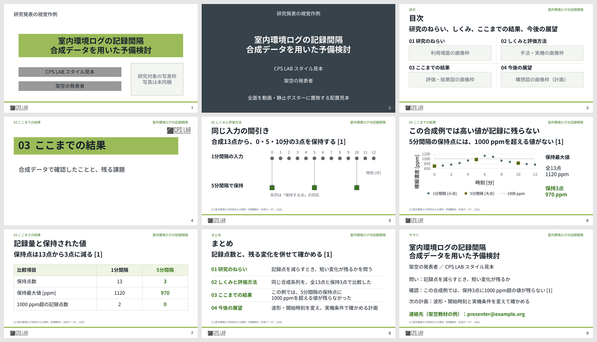

[編集可能な見本PPTX](assets/visual-reference/cps-layout-reference.pptx) · [発表メモ](assets/visual-reference/cps-layout-reference-発表メモ.txt) · [作例の説明と検証範囲](references/visual-reference.md) · [企画から図までの通し作例](references/worked-example.md)

<details>
<summary>作例を1枚ずつ見る（全9枚）</summary>

### 1. 表紙タイプA

題目帯、所属・発表者帯、研究対象の写真を組み合わせる表紙です。見本の写真部分は配置枠です。

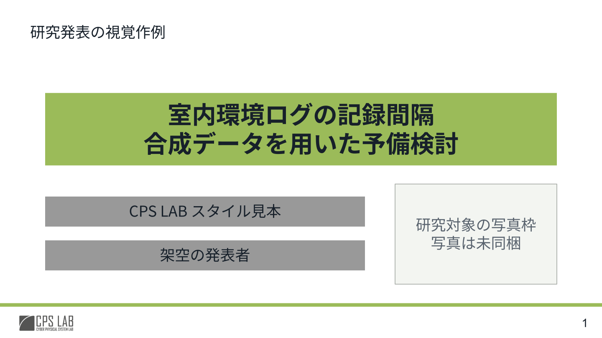

### 2. 表紙タイプB


全画面の背景に白文字を重ねる表紙です。見本は静止レイアウトで、背景動画は同梱していません。

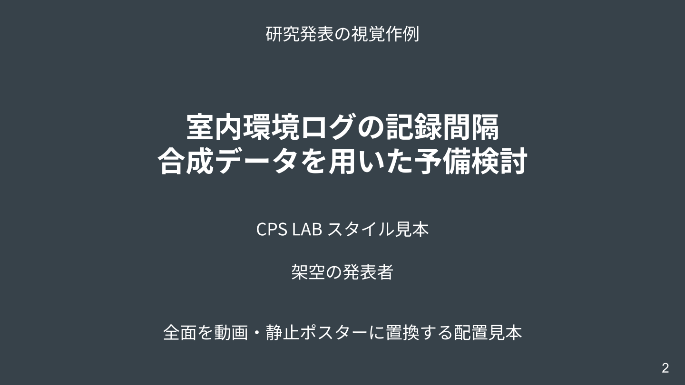

### 3. 画像付き2×2目次

4章と各章の画像を対応させます。見本の画像部分は配置枠です。

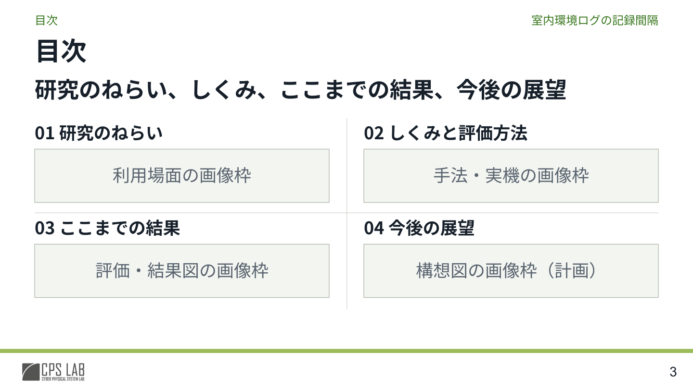

### 4. 上部型の章扉

上部の色帯に章番号と章名を置き、その下に案内文を添えます。

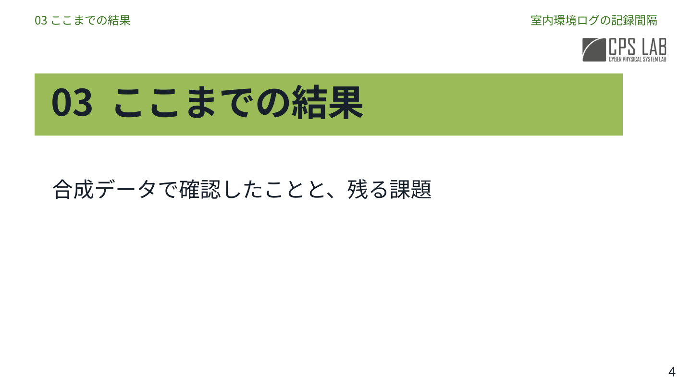

### 5. 模式図

上部に話題とメッセージ、下部に主図を配置します。PPTXでは点・接続線・文字を個別に編集できます。

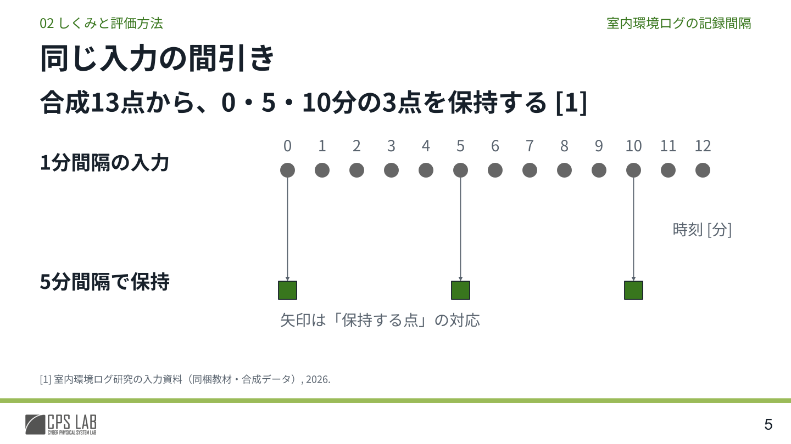

### 6. 定量図

軸・単位・系列と短い正確な主張を示す散布図です。詳しい条件は同梱の発表メモに記録しています。PPTXには編集可能なチャートとデータを収録しています。

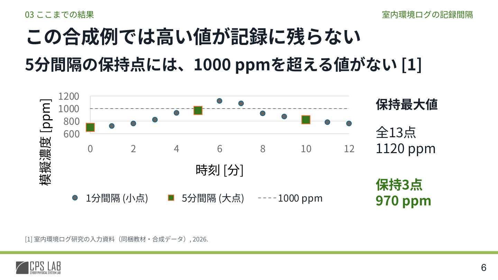

### 7. 比較表

条件ごとの値を、単位を付けた表で比較します。PPTXでは表のセルを編集できます。

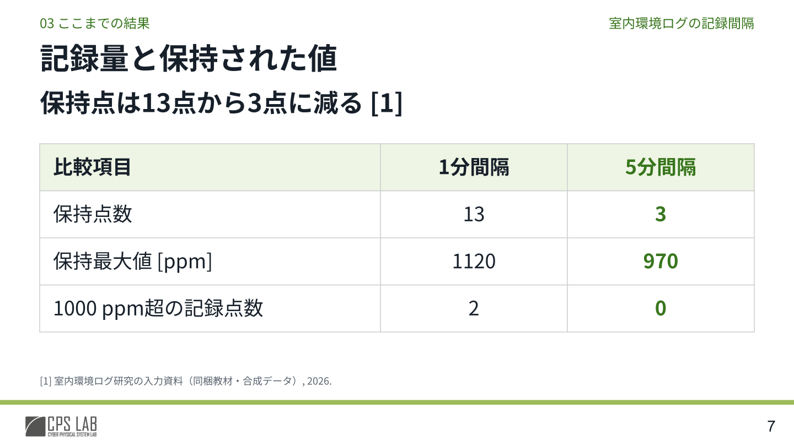

### 8. 縦4行のまとめ

目次と同じ章名・順序で、各章の要点を振り返ります。

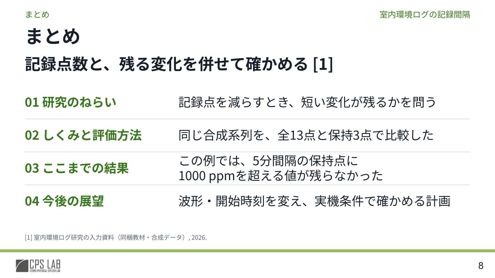

### 9. 最終サマリ

発表の概要、著者・所属、連絡先をまとめる最後のページです。教材の連絡先は架空例として明示しています。

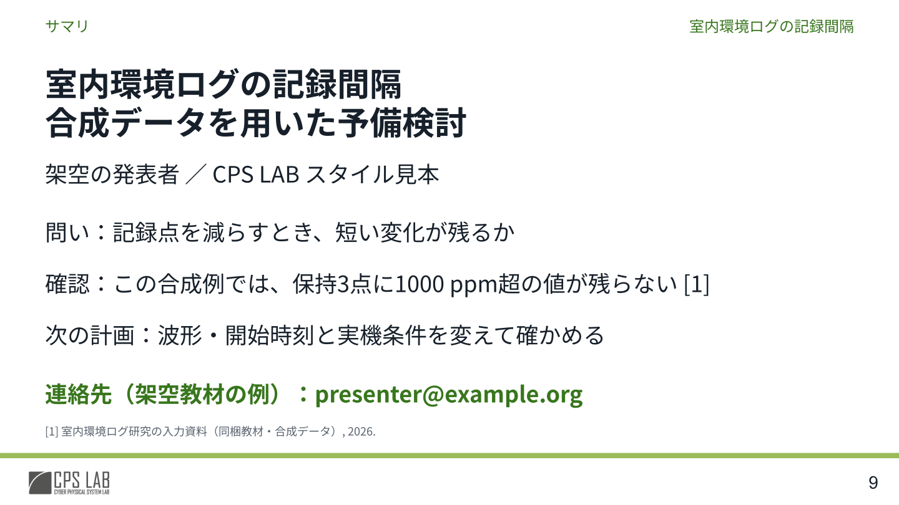

</details>

実際の成果物は利用者の研究プロジェクトへ保存します。このリポジトリには、再利用するスキル・素材・ひな形と、明示した架空作例を収録しています。

## 選べる配色（6種類）

ベースカラーはすべて白 `#FFFFFF`。同じレイアウトで、メイン色と独立したアクセント色の使い分けを比較できます。各画像は編集可能な[配色見本PPTX](assets/palette-reference/cps-color-reference.pptx)の表示確認用レンダーです。

| 配色 | メイン | アクセント |
|---|---|---|
| アイリス | `#8064A2` | `#543477` |
| kiMera | `#FACADF` | `#A61C60` |
| オレンジ | `#F79646` | `#B45F06` |
| シチリア | `#4BACC6` | `#165F73` |
| ボタニカ | `#9BBB59` | `#38761D` |
| ボルドー | `#C0504D` | `#8B2523` |

### アイリス

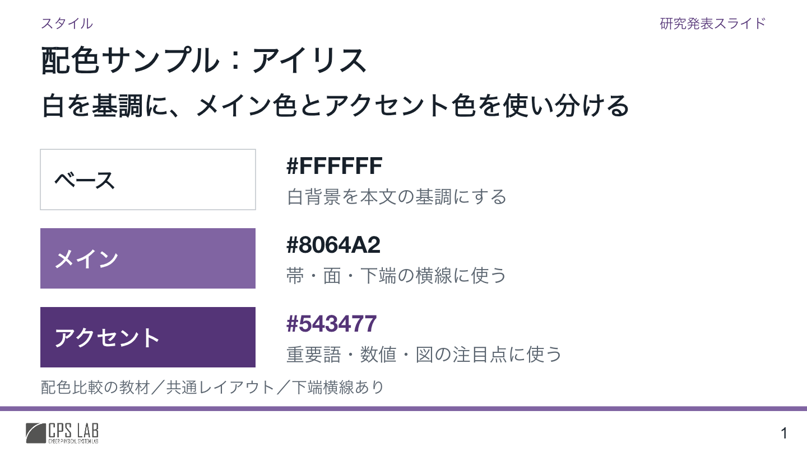

### kiMera

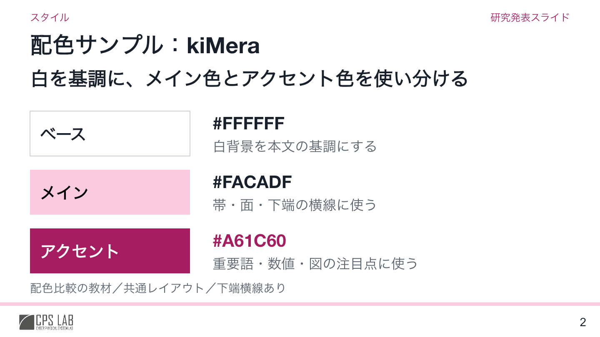

### オレンジ


### シチリア

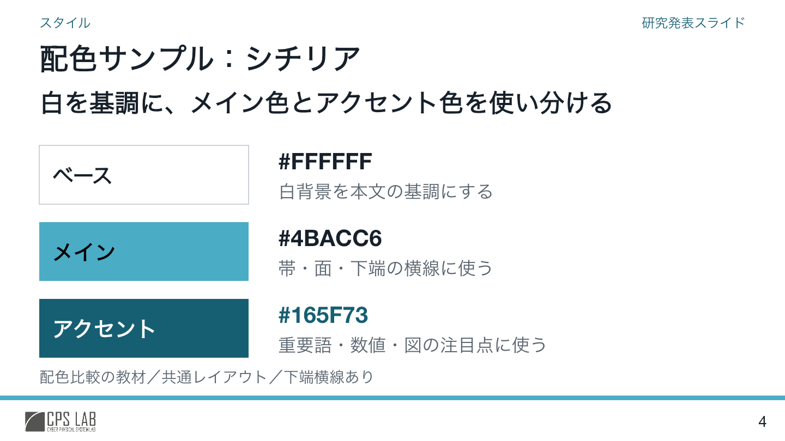

### ボタニカ

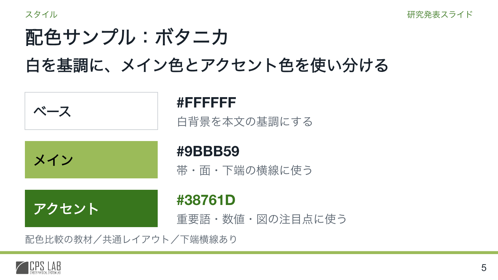

### ボルドー

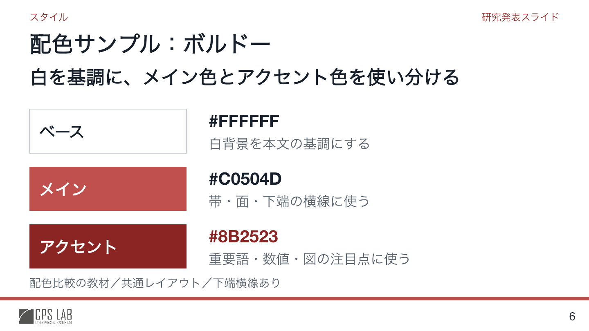

色の用途・文字色・指定方法は[スタイル仕様](references/cps-lab-style.md)、再生成は[配色見本の説明](references/palette-reference.md)を参照してください。

## 導入

以下は初めて使うメンバー向けの手順です。**スキルの取得 → ツールの導入 → 動作確認 → 自分の研究で制作**の順に進めます。PPTX生成には公開パッケージを使い、Codex専用の制作ライブラリを必要としません。利用するAIサービスの契約・ログインは別途必要です。

### 1. Git・Node.js・uvを用意する

既に使えるものは再インストールしません。所属先でNix等を使っている場合は、その管理方法でも構いません。

| ツール | 用途 | 導入方法 |
|---|---|---|
| Git | スキルの取得・更新 | [公式導入ページ](https://git-scm.com/install/)でOSを選ぶ |
| Node.js | 編集可能なPPTXの生成 | [公式ダウンロード](https://nodejs.org/en/download)から、20以上のサポート中LTSを入れる。npmも使用する |
| uv | Pythonと検査・描画用ライブラリの管理 | [公式導入手順](https://docs.astral.sh/uv/getting-started/installation/)を使う。Pythonは後の `uv sync` で用意できる |

uvの公式インストーラーを使う例です。

macOS・Linux：

```sh
curl -LsSf https://astral.sh/uv/install.sh | sh
```

Windows PowerShell：

```powershell
powershell -ExecutionPolicy ByPass -c "irm https://astral.sh/uv/install.ps1 | iex"
```

インストール後はターミナルを開き直し、次を確認します。

```sh
git --version
node --version
npm --version
uv --version
```

### 2. スキルをGitHubから取得する

macOS・Linuxのターミナルで実行します。既存の同名フォルダがある場合は[更新について](#更新について)を先に確認してください。

```sh
mkdir -p "$HOME/.agents/skills"
git clone https://github.com/cpslab/skill-create-slides.git \
  "$HOME/.agents/skills/research-presentation-slides"
cd "$HOME/.agents/skills/research-presentation-slides"
```

Windows PowerShellでは次を使います。

```powershell
New-Item -ItemType Directory -Force "$HOME/.agents/skills" | Out-Null
git clone https://github.com/cpslab/skill-create-slides.git "$HOME/.agents/skills/research-presentation-slides"
Set-Location "$HOME/.agents/skills/research-presentation-slides"
```

Gitを使わない場合はGitHubの **Code → Download ZIP** から取得し、フォルダ名を `research-presentation-slides` にして同じ場所へ置きます。`SKILL.md` だけでなく、`assets/`・`references/`・`scripts/`・依存定義とlockファイルを含むフォルダ全体が必要です。この手順は **1.6.0の内容を取得した場合**を対象とします。取得した `SKILL.md` が旧版なら、配布担当者が指定したリリース・ブランチを確認してください。

### 3. 利用するエージェントへ登録する

| 利用環境 | 導入・ログイン | スキルの呼び出し |
|---|---|---|
| Codex | [公式案内](https://learn.chatgpt.com/docs/build-skills)に従ってCodexを用意する。上記 `.agents/skills` を認識する | `$research-presentation-slides` |
| OpenCode | [公式導入手順](https://opencode.ai/docs/)で使用する版を導入し、プロバイダーへ接続する。上記 `.agents/skills` を認識する | `research-presentation-slides スキルを読み込んでください` |
| Claude Code | [公式導入手順](https://code.claude.com/docs/en/setup)で導入し、`claude` を起動してログインする。下記のリンクを追加する | `/research-presentation-slides` |

<details>
<summary>OpenCode・Claude Codeをまだ導入していない場合</summary>

OpenCodeの公式手順にあるnpm版を使う例（OpenCode 1）：

```sh
npm install -g opencode-ai
opencode
```

起動後に `/connect` で利用するプロバイダーへ接続します。OpenCode 2を使う場合は [V2の導入案内](https://opencode.ai/v2/docs/) を使ってください。両版は既定で同じ `opencode` コマンドを使用するので、既に導入してある版を確認してから選びます。

Claude Codeの公式インストーラーを使う例（macOS・Linux）：

```sh
curl -fsSL https://claude.ai/install.sh | bash
claude
```

Windows PowerShell：

```powershell
irm https://claude.ai/install.ps1 | iex
claude
```

初回起動時の案内に従ってログインします。`Not logged in` と表示された場合は、Claude Code内の `/login` を実行します。インストーラーや対応OSの最新条件は表の公式ページを参照してください。

</details>

OpenCodeは `.agents/skills` と `.claude/skills` の両方を探索します。Claude Codeは個人用スキルを `.claude/skills` から読み、スキルフォルダへのシンボリックリンクも扱えます。[OpenCodeのスキル仕様](https://opencode.ai/docs/skills/)・[Claude Codeのスキル仕様](https://code.claude.com/docs/en/skills)

Claude Codeを使う人は、同じスキル本体を参照するリンクを1回だけ作ります。**既存の同名スキルへ上書きしません。**

macOS・Linux：

```sh
mkdir -p "$HOME/.claude/skills"
ln -s "$HOME/.agents/skills/research-presentation-slides" \
  "$HOME/.claude/skills/research-presentation-slides"
```

Windows PowerShell（同じPC内のフォルダへジャンクションを作成）：

```powershell
New-Item -ItemType Directory -Force "$HOME/.claude/skills" | Out-Null
New-Item -ItemType Junction -Path "$HOME/.claude/skills/research-presentation-slides" -Target "$HOME/.agents/skills/research-presentation-slides"
```

Claude Codeだけを使う場合は、手順2のクローン先を最初から `.claude/skills/research-presentation-slides` にしても構いません。その場合、以後のコマンドのスキルの場所も読み替えます。登録後に新しいセッションを開き、スキルの読込み元と版を確認してください。同名の古いコピーを複数の探索先へ残さないようにします。

### 4. 生成・描画用ツールを入れる

スキルのフォルダで実行します。以下はmacOS・Linux・Windowsで共通です。

```sh
npm ci
uv sync --frozen --python 3.12
```

`package-lock.json` に従いPptxGenJS・sharpを、`uv.lock` に従いPyMuPDF・Pillowを導入します。利用者が使っているni等から同等のlock付き導入を行っても構いません。`node_modules/` と `.venv/` は各PCで作る実行環境で、他のPCへコピーする配布物には含めません。

続いて、PPTXをPDFへ書き出す **LibreOffice** と、日本語表示用の **Noto Sans JP** を入れます。

| OS | LibreOffice | Noto Sans JP |
|---|---|---|
| macOS | [公式ダウンロード](https://www.libreoffice.org/download/download-libreoffice/)でIntel／Apple Siliconを確認して選ぶ。DMGを開き、Applicationsへ移動する | [Google Fonts](https://fonts.google.com/noto/specimen/Noto+Sans+JP)から取得し、展開したフォントをFont Bookでインストールする |
| Windows | 同じ公式ページでOS・CPUに合うインストーラーを選び、画面の案内に従う | ダウンロードしたフォントを右クリックしてインストールする |
| Linux | ディストリビューションのパッケージ管理でLibreOfficeのImpressを含めて導入する | ダウンロードしたフォントをユーザーのフォントフォルダ等へ入れ、利用環境のフォントキャッシュを更新する |

LibreOfficeのOS別手順は[公式インストール案内](https://www.libreoffice.org/installation-instructions/)も参照してください。WindowsのWSLを使う場合は、Node・Python・LibreOffice・フォントもWSL内へ揃えます。Windows側だけへ入れたアプリがLinuxのコマンドとして使えるとは仮定しません。

macOSのPowerPointを既に利用している場合は、LibreOfficeの代わりに `--renderer powerpoint` を指定する経路もあります。発表先がPowerPointなら、LibreOfficeでの静止表示確認に加えて発表先アプリで開き、動画・編集・スライドショーの動作を確認します。

### 5. 環境と画像制作機能を確認する

次はスキルのフォルダから実行します。記録は研究用フォルダへ保存し、パスは自分の保存先へ変更してください。

```sh
uv run --frozen python scripts/doctor.py --backend portable --strict \
  --report /path/to/my-research/presentation/environment.json
```

Windowsでも同じオプションを使えます。コマンドを1行で入力し、保存先を `"C:/Users/自分の名前/Documents/my-research/presentation/environment.json"` 等へ変更します。LibreOfficeを通常と異なる場所へ入れた場合は、環境変数 `SOFFICE` に実行ファイルの場所を設定できます。[詳細な生成・描画コマンド](references/generation.md#公開ツールで生成検証する標準)

**doctorは生成・描画の依存確認です。画像生成と画像閲覧は、選んだモデルと接続済みツールで実際に利用できるか別に確認します。** モデル名や契約名だけで利用可能と判断しません。画像生成サービスは固定せず、エージェントが利用できる機能を選びます。生成が必要な画像の用途・参照素材・寸法・品質・実物との違いを渡し、出力画像を確認します。追加サービスの契約・料金や外部送信が必要な場合は、その機能の利用条件を確認します。

画像生成や画像閲覧が利用できない場合は不足を明示し、対応モデル・ツールを用意して再開します。必要な画像を作れない状態を、完成イメージのレビュー済みや全ページ確認済みとして扱いません。

### 6. 架空作例で生成から描画まで試す

スキルのフォルダで実行します。以下はMac/Linuxの例です。`SLIDE_TRIAL_DIR` はスキルとは別の、新しい作業フォルダにしてください。WindowsではPowerShellの `$SlideTrialDir` に同じ用途のパスを設定して各コマンドを1行で実行できます。

```sh
SLIDE_TRIAL_DIR="$HOME/Documents/slide-skill-trial"

uv run --frozen node scripts/build_deck.mjs --backend portable \
  --input assets/plan-reference/input.json --work-dir "$SLIDE_TRIAL_DIR" \
  --output "$SLIDE_TRIAL_DIR/output/plan-v1.pptx"

uv run --frozen python scripts/render_portable.py \
  --input "$SLIDE_TRIAL_DIR/output/plan-v1.pptx" \
  --output-dir "$SLIDE_TRIAL_DIR/render-v1" --renderer libreoffice

uv run --frozen python scripts/check_pptx.py "$SLIDE_TRIAL_DIR/output/plan-v1.pptx" \
  --expect-slides 7 --report "$SLIDE_TRIAL_DIR/structure-v1.json"

uv run --frozen python scripts/check_layout.py "$SLIDE_TRIAL_DIR/output/plan-v1.pptx" \
  --profile assets/profiles/cps-workshop.json --deck-spec assets/plan-reference/input.json \
  --report "$SLIDE_TRIAL_DIR/layout-v1.json"
```

これは固定入力の内部試験で、利用者レビューや新規画像生成は行いません。既存の出力は上書きしないため、再試行では `plan-v2.pptx`・`render-v2` など新しい名前を使います。PPTX・発表メモ・配置対応表、全ページPNG・一覧・hash付き描画記録が作成されます。PNGを1枚ずつ開いて表示を確認してください。配置検査の終了値2は要確認事項が残る状態です。個別確認と[最終品質判定](references/generation.md#個別目視と最終判定)まで行って、初めて検証済みと記録します。

## 使い方

研究資料があるフォルダを利用するエージェントで開きます。OpenCodeならそのフォルダで `opencode`、Claude Codeなら `claude` を起動します。開始時のワーキングディレクトリを基点に、エージェントが直下と既存のサブディレクトリから関連する論文・研究計画・結果・素材を確認します。`sources/` や `assets/` を作ったり、資料を移動・改名したりする準備は不要です。特定のファイルや範囲だけを使いたい場合は、その指定を優先します。

スキルの導入先と研究資料の作業先は別です。同梱の `assets/` はロゴ・ひな型・架空作例等の配布物で、利用者の入力フォルダ名を指定するものではありません。次は全クライアントで使える依頼例です。Codexでは先頭を `$research-presentation-slides`、Claude Codeでは `/research-presentation-slides` にしても構いません。

```text
research-presentation-slides スキルを読み込んでください。
読込み元・バージョンと、PPTX生成・描画・画像生成・画像閲覧の機能を確認してください。

このワーキングディレクトリにある資料を、既存のサブディレクトリも含めて確認し、
今回の研究に関連する資料・素材を元の配置のまま入力に使ってください。
学会の10分発表を制作してください。質疑は別に5分です。
聴衆は情報工学系の学生・研究者、言語は日本語です。
発表者・所属：［氏名・所属］
掲載する連絡先：［メール・URL、または掲載しない］
保存先：presentation/my-talk/

短い研究発表型（cps-workshop）、表紙タイプA、フッター横線なし。
未実施の内容は計画として扱い、必要な枚数を提案してください。
編集可能なPPTXと必要な発表メモを制作し、全ページを描画して確認してください。
まずスタイルと企画書を提示し、各レビューで私の確認を待ってください。
```

表紙タイプBにしたい場合は「表紙は表紙タイプB。背景動画は○○」と指定します。表紙が未指定なら2択で確認します。本文は表紙選択から独立しています。`cps-midterm` は画像付き2×2目次・4章・上部型章扉・縦4行まとめ、`cps-workshop` は研究に合う章数・縦目次・章扉の採否・本編末尾のサマリを選びます。装置・UI・定量結果がない研究も計画や概念に合う型で制作します。

開始時には制作の流れと、次にレビューしてほしい成果物を案内します。成果物を提示するときも、見るべき点と回答方法を伝えます。修正点を返すか、問題なければ「この案で次へ」と返してください。

分かる情報だけで始められます。エージェントが資料から[入力票](assets/input-brief.md)を整理し、次の判断に必要な不足を確認します。既存のスタイルを使う場合は、その資料も渡してください。

途中から再開する場合の例：

```text
$research-presentation-slides
企画書とスタイルは確認済みです。添付した制作記録を読んで、
今日はアウトラインとスライド構成まで進めて。
```

後ろの工程ほど、より推論能力の高いモデルを使うことを勧めます。草案では速度、アウトライン以降は推論能力を重視し、PPTX制作・最終検証では利用可能な範囲で最も強い推論モデルを推奨します。工程の切り替わりに案内しますが、変更は任意です。画像生成は、選択したモデルと接続済みツールの実際の能力から方法を決めます。

完成イメージとPPTXの作成前には、スタイルの参考にしたいスライドを任意で提示できます。CPS LABの基本を残し、文字の組み方・配色・図の大きさなどを参考へ寄せます。参考なしでも進められます。PPTX制作前に見た目を変更する場合は、完成イメージを更新して再レビューします。

既存資料の改訂などで、特定工程を省略して直接編集するよう明示した場合は、その指定を優先します。省略したレビューと、実施した内容・表示・手修正保持の検証は分けて記録します。

各配色はベース・メイン・独立したアクセントの3色を必ず定義します。ボタニカは白／`#9BBB59`／`#38761D`。他の5配色も[対応表](references/cps-lab-style.md)に濃い同系色のアクセントを定義しています。

下端のメインカラーの横線は、スタイル設定時に**あり／なし**を選べます。線なしでもロゴとページ番号は残ります。元から線を置かない章扉・表紙タイプBはそのままです。

表紙以外の全ページには左上に小さな章タイトル、右上に短縮発表タイトルを表示します。目次・まとめ・補足・サマリでは、章タイトルの代わりにページ種別を表示します。引用箇所に `[1]`・`[1-4]` 等を付け、同じページ下部に参考文献を載せます。概要・著者・所属・表示を指定した連絡先のサマリは、中間発表型では補足後、短い研究発表型では本編末尾を既定とします。補足後の再掲や連絡先の省略は別に選べます。

## 必要な環境

公開ツール経路では、Node.js 20以上・Python 3.10以上・lock付き依存・LibreOffice・Noto Sans JPを使用します。画像を読み取れるモデルまたは確認手段と、今回必要な画像を生成・編集できる機能も準備します。スキルの配置だけでは、ツール・権限・契約・フォントは追加されません。導入方法は上の[導入](#導入)、能力の確認範囲は[導入と実行条件](references/sharing.md)を参照してください。

Codexの `Presentations`・`@oai/artifact-tool` が利用可能な環境では、従来の `--backend codex` も選べます。OpenCode・Claude Codeにこれらの非公開ランタイムがあるとは仮定しません。通常は `--backend portable` を使います。

## 共通の品質基準と見本

研究内容は各メンバーの資料に基づき、根拠・論理・可読性・編集可能性を同じ[完成基準](references/quality-standard.md)で確認します。生成文章や画像の完全一致を要求するものではありません。

| 資料 | 用途 |
|---|---|
| [スキル本体](SKILL.md) | 6工程と対話・再開の手順 |
| [CPSスタイル](references/cps-lab-style.md) | 2つのプロファイル、色、余白、文字階層、ロゴ配置 |
| [レイアウト選択](references/layout-patterns.md) | 問い・写真・表・UI・結果・分岐などの用途と選び方 |
| [再生成と検査](references/generation.md) | 入力と共通部品、環境確認、生成・検査の実行方法 |
| [通し作例](references/worked-example.md) | 根拠から企画書、メッセージ、図へ変換する具体例 |
| [編集可能な見本PPTX](assets/visual-reference/cps-layout-reference.pptx) | 表紙2種類、目次、章扉、模式図、定量図、表、まとめ、最終サマリの9種類 |
| [視覚作例の説明](references/visual-reference.md) | 比較ポイント、検証範囲、再生成方法 |
| [検証記録のひな形](assets/quality-review.md) | 確認結果と未検証事項の記録 |

見本の研究・データは架空です。実際の研究結果として使用しないでください。見本の表紙・目次には未提供素材の配置枠があり、表紙タイプBの実動画は同梱していません。9枚の見本PPTXは構造検査に加え、1.5.0の[検証記録](assets/visual-reference/validation.json)でPowerPoint 16.111のPDF書出しとPoppler Cairoによる全ページ個別目視を記録しています。この9枚の編集・再保存と動画再生は未検証です。7枚の計画作例では、別の試験用コピーによる文字・表の編集、保存、再オープンも記録しています。各検証は記録したファイルと操作の範囲に限り、別環境での表示や全要素の編集を保証しません。

## 生成と検査

研究の根拠は利用者の資料、編集する構成の正本は `slide-structure.md` とし、承認済みの版と照合したJSONを生成入力にします。MarkdownとJSONは自動同期されません。修正は構成正本・生成入力・共通部品・コードへ戻し、再生成で維持します。コマンド、依存関係、出力の対応は [再生成と検査](references/generation.md) を参照してください。

```sh
uv run --frozen python scripts/init_presentation.py --project-dir /path/to/presentation --title '研究発表'
uv run --frozen python scripts/doctor.py --backend portable --strict --report /path/to/presentation/environment.json
uv run --frozen python scripts/check_pptx.py assets/visual-reference/cps-layout-reference.pptx --expect-slides 9
```

`init_presentation.py` は `workflow.md` だけを初期化します。既存の `workflow.md` または `workflow.org` がある場合は上書きや二重作成をせず、終了値2で作成を止めます。その既存の制作記録をエージェントが引き継いで使います。

PPTX生成は `uv run --frozen node scripts/build_deck.mjs --backend portable --input INPUT.json --work-dir WORK --output WORK/output/deck-v1.pptx` を使います。最終PPTXは作業先配下の独立した出力ディレクトリへ保存し、既存PPTXへの上書きを拒否します。候補・検証記録は `.build/` へ分離し、成功時は最終PPTXと同じ場所へ `.layout.json` と `-発表メモ.md` も出力します。既存の同名TXTメモを引き継ぐ場合は形式を保ち、Markdownとの二重作成を避けます。

公開ツール経路の `render_portable.py` はLibreOfficeまたはmacOSのPowerPointからPDFを書き出し、PyMuPDFで全ページを描画します。Codex用の `render_deck.mjs` は既定の `artifact-tool` に加え、macOSのPowerPointとPopplerを使う `--renderer powerpoint`、対象アプリが書き出したPDFを使う `--renderer pdf` に対応します。全ページPNG・一覧・hash付き描画記録を出力します。PDF経路は書出し元PPTXのhashと実際の書出しログを別途照合します。画像の一覧化だけでは個別目視を合格にしません。

表紙タイプBは提供された静止ポスターを必須とし、MP4があれば自動開始・ループ・消音の設定付きで埋め込めます。埋込検査と対象アプリでの再生確認を分け、実際に操作していない再生・停止等は未検証として残します。

Pythonの検査コードは標準ライブラリを基本とします。PPTX生成・レンダーのNode依存とフォントは別途必要です。構造検査、配置検査、全ページ個別目視、意味・編集可能性・対象アプリ動作を区別します。終了値0だけで完成とせず、[Q1〜Q11](references/quality-standard.md#最終受入の11項目)を個別に判定します。固定入力の開発内部試験では利用者レビューを捏造しません。

## 更新について

Gitで導入し、ローカルでファイルを変更していない場合は、導入先で `git pull --ff-only` を実行します。独自の変更がある場合は、差分を保存してから更新内容を統合してください。

同名の旧スキルが `.codex/skills/` などにある場合は、必要な旧版を検索対象外へ保存し、使用する版を1つにします。既存ファイルを無条件で上書きしないでください。

## 発表用メモ

主張を補足・限定して説明したい箇所は、スライド上の細かな注意書きを増やさず、出力PPTXと同じディレクトリの `発表資料-発表メモ.md` に記録します。ページ番号・スライドIDごとに、発表時に口頭で伝える補足、適用範囲・条件・未確認事項、根拠をまとめます。必要な箇所があればメモも納品され、PPTXの修正・並べ替えに合わせて更新します。[メモひな形](assets/presentation-memo-template.md)を使えます。

まず主張や図ラベルを根拠に合う短い表現へ直します。対象・分母・単位・比較条件・実測／例示／計画など、省くと結論の理解が変わる情報は読める形で画面にも残します。詳しい方法・補足・限定はメモへ送ります。長い発表原稿・想定質問集とは別の、発表者が該当ページを話すときに参照するメモです。

## 同梱ファイルの管理

現在のスキル版は **1.6.0** です。[package-manifest.json](package-manifest.json)にはスキルの配布ファイルとSHA-256、見本の検証範囲を記録しています。README・AGENTS・検査コードも一覧に含め、Git設定・キャッシュ・manifest自身はhash一覧の対象外です。[配布検査](references/generation.md#配布物を確認更新する)は `scripts/check_package.py` で実行できます。

PNG・PPTXは、メンバーが制作環境なしでも見本を確認できるよう同梱しています。合成入力は [example-source.org](assets/example-source.org)、生成コードは [build.mjs](assets/visual-reference/build.mjs)、再生成手順は[視覚作例の説明](references/visual-reference.md)にあります。フォントや制作エンジンは同梱していません。
