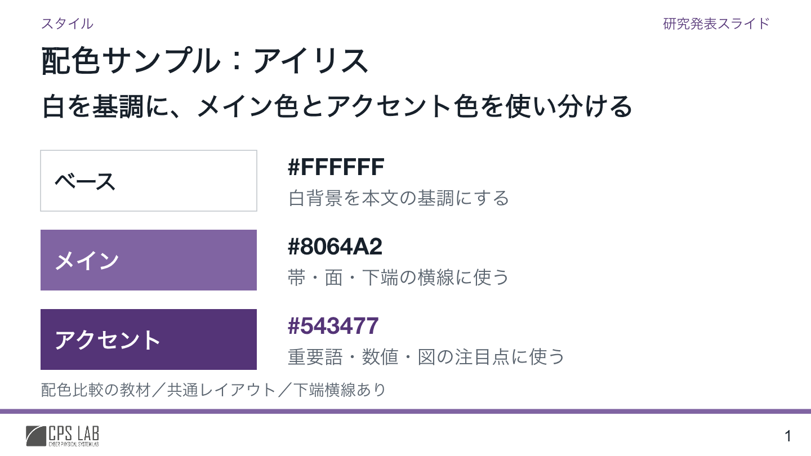
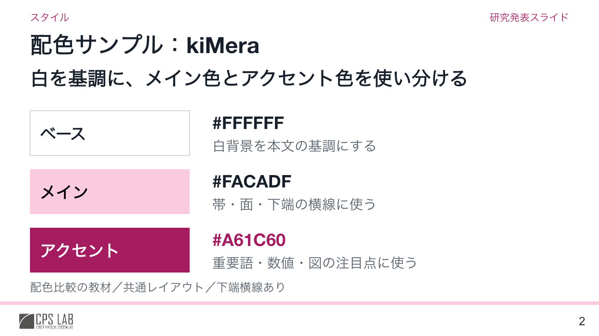
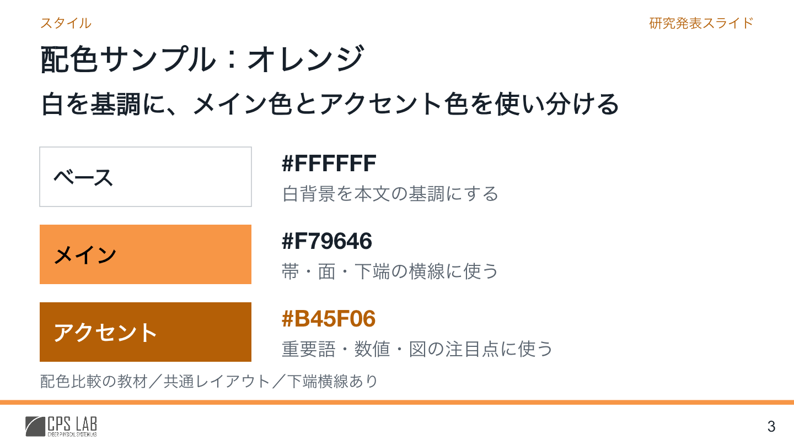
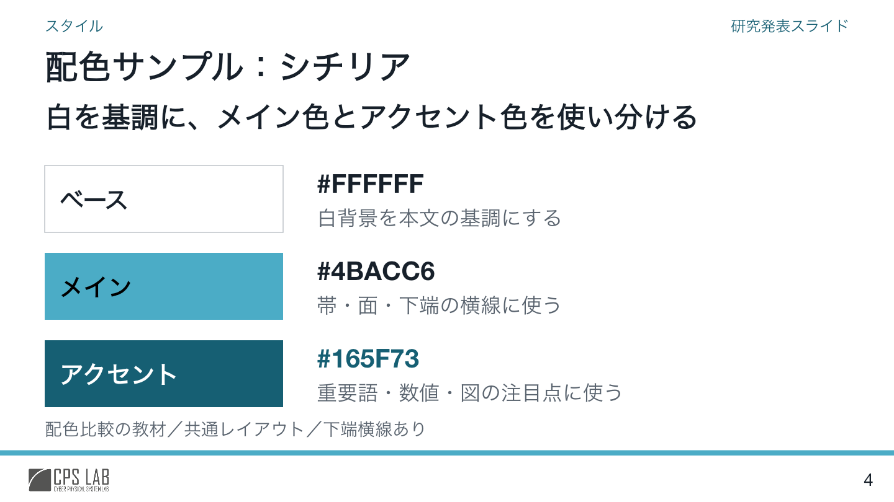
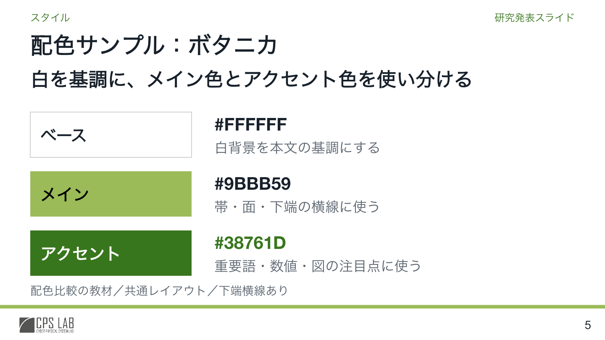
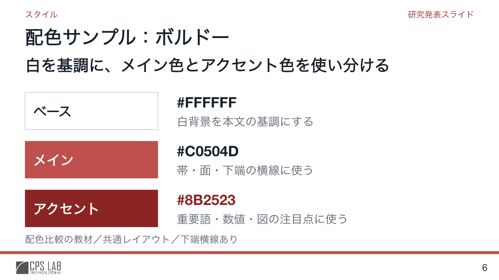

# 研究発表スライド制作スキル

論文・研究計画・実験結果をもとに、相談しながら**編集可能なPowerPointと発表メモ**を作るスキルです。Codex・OpenCode・Claude Codeで使えます。「企画書だけ」「途中から再開」「既存PPTXの修正」にも対応します。

[初めての導入](#導入) · [依頼文の例](#使い方) · [文章の推敲と図の作成](#文章の推敲と図の作成) · [デザインと作例](#デザインと作例)

## 使い方

研究資料があるフォルダでエージェントを開き、次の依頼文を送ってください。資料を移動したり、入力用フォルダを作ったりする必要はありません。使うファイルを限定したい場合は、そのパスを指定します。

```text
research-presentation-slides スキルを読み込んでください。

このフォルダとサブディレクトリの研究資料を使って、
学会の10分発表を作ってください。質疑は別に5分です。
聴衆：情報工学系の学生・研究者
言語：日本語
発表者・所属：［氏名・所属］
連絡先：［メール・URL、または掲載しない］
保存先：presentation/my-talk/

短い研究発表型（cps-workshop）、表紙タイプA、フッター横線なし。
未実施の内容は計画として扱ってください。
編集可能なPPTXと発表メモまで作りたいです。
まずスタイルと企画書を提示し、各レビューで私の確認を待ってください。
```

呼び出しの先頭は、Codexなら `$research-presentation-slides`、Claude Codeなら `/research-presentation-slides` でも構いません。分かる情報だけで始められます。

参考にしたいスライドや、自分で修正した文章も渡せます。「文体だけ参考に」「見た目も合わせて」のように用途を伝えてください。

## 制作の流れ

**スタイル → 企画書 → アウトライン → スライド構成と図 → 完成イメージ → PPTX**

次の3か所で作業を止め、あなたの確認を待ちます。

| 確認するもの | 見てほしい点 |
|---|---|
| 企画書 | 研究のねらい・今回伝える範囲・結論 |
| アウトライン | 話の順序・抜けや重複・時間配分 |
| 完成イメージ | 全ページを1枚に並べた画像の配置・図・文字・統一感 |

修正点を伝えるか、問題なければ「この案で次へ」と返してください。一括制作でもこの確認を挟みます。特定工程を省略して直接編集したい場合は、その対象を明示してください。

完成時はPPTXの全ページを描画して確認し、必要な補足を同じフォルダの発表メモへまとめます。企画書・構成・メモはMarkdownが標準です。既存のOrg・TXTや手修正は保持します。

途中からなら「この企画書とスタイルは確認済み。アウトラインから再開して」、既存資料なら「このPPTXを基準に、指定箇所だけ直して」と依頼できます。

### 文章の推敲と図の作成

このスキルに発表制作を依頼すると、次の手順も適用されます。どちらも追加インストールは不要です。

- **日本語の推敲（yomiyasu）**　企画書、アウトライン、スライド本文・図ラベル、発表メモを提示する前に、草稿を研究資料と読み比べます。文章を短くしても、比較条件や「予備試験で見られた傾向」などの限定、発表者が手で直した表現を保ちます。公式スキルを使える環境では公式版を、それ以外では研究発表向けにまとめた同梱の手順を使います。[推敲の手順](skills/research-presentation-slides/references/writing-style.md#yomiyasu-で草稿を推敲する)
- **研究図の作成（heydamir/unslop）**　各図で聴衆に読み取ってほしい関係を決め、余白、配置、ラベル、強調色に反映します。完成時はスライド上の大きさで図を見て、意図した順に読めるかを確認します。UIデザイン用の原典を研究図向けに翻案した手順です。[図の設計と見直し](skills/research-presentation-slides/references/figure-design-unslop.md)

1枚だけ直す場合も、「3枚目の結果を示す一文を、比較条件を残して短くしてください。図では、どの値を比べるのかが一目で分かるようにしてください」と依頼できます。

## 導入

利用するエージェントの導入・ログインに加え、次を用意します。

- Git、Node.js（npm・npxを含む）、uv。下記の `npx skills` による導入にはNode.js 22.20.0以上、PPTX生成には20以上を使います。
- LibreOffice、日本語フォントのNoto Sans JP
- 画像の生成・編集と、出力画像を確認できるモデル・ツール

macOSのPowerPointを描画に使う経路もあります。スキルを置くだけでは、これらのツールや利用権限は追加されません。

### 1. スキルを取得する

研究プロジェクトのフォルダで次を実行し、使うエージェントと導入先を選びます。

```sh
gh skill install cpslab/skill-create-slides
```

Codexへ個人用に導入する場合は、次のように指定できます。

```sh
gh skill install cpslab/skill-create-slides research-presentation-slides --agent codex --scope user
```

`npx skills add cpslab/skill-create-slides` でも導入できます。こちらで個人用に導入する場合は `-g` を追加します。[GitHub CLIの導入オプション](https://cli.github.com/manual/gh_skill_install) · [Skills CLIの導入オプション](https://github.com/vercel-labs/skills/blob/main/docs/commands.md#skills-add)

CLIが表示した導入先でPPTX生成・検査用の依存を入れます。たとえばCodexのプロジェクト用に導入した場合は次のとおりです。

```sh
cd .agents/skills/research-presentation-slides
npm ci
uv sync --frozen --python 3.12
```

Gitでクローンする場合やZIPで取得する場合は、[詳しい導入手順](skills/research-presentation-slides/references/installation.md)を参照してください。

### 2. 環境を確認する

スキルのフォルダで実行します。保存先は自分の研究フォルダへ置き換えてください。

```sh
uv run --frozen python scripts/doctor.py --backend portable --strict \
  --report /path/to/my-research/environment.json
```

PowerPointを使う場合は `--renderer powerpoint` を追加します。doctorとは別に、選んだモデル・ツールで画像生成と画像閲覧ができるかも確認してください。

**[Windowsを含むOS別の導入・クライアント登録・作例での動作確認](skills/research-presentation-slides/references/installation.md)** に詳しい手順があります。導入後は新しいセッションでスキルの読込み元と版を確認し、[依頼文の例](#使い方)から始めてください。

## デザインと作例

| 構成 | 向いている発表・特徴 |
|---|---|
| 中間発表型 `cps-midterm`（既定） | 進捗を4章で整理。画像付き2×2目次・章扉・縦4行まとめ |
| 短い研究発表型 `cps-workshop` | 問いと議論に絞る発表。章数は可変・縦目次・章扉の有無を選択 |

表紙は構成と別に、**タイプA（題目帯＋写真）／タイプB（背景動画）**から選びます。配色とフッター横線の有無も指定できます。目次と、表紙から始まる全ページの連番は両型で必須です。

撮影写真をデッキ全体に1点以上、研究全体の概要図を本編に1点以上使います。画像・イラストは本文10枚あたり合計12〜16点程度を7〜8割のページへ、そのうちイラストは6〜8点程度を約半数のページへ配置するのが標準です。減らしたい場合は「イラストを少なめに」などと指定してください。適したデータがあればグラフも検討します。[素材の数え方と要件](skills/research-presentation-slides/SKILL.md#写真と研究全体の概要図は必須画像とイラストは標準量グラフは推奨)

### 作例を見る

| 作例 | プレビュー・ファイル |
|---|---|
| 中間発表型のレイアウト9種類 | [一覧画像](skills/research-presentation-slides/assets/visual-reference/contact-sheet.png) · [PPTX](skills/research-presentation-slides/assets/visual-reference/cps-layout-reference.pptx) |
| 短い研究発表10枚 | [一覧画像](skills/research-presentation-slides/assets/workshop-reference/contact-sheet.png) · [PPTX](skills/research-presentation-slides/assets/workshop-reference/workshop-reference.pptx) |
| 研究計画7枚 | [一覧画像](skills/research-presentation-slides/assets/plan-reference/contact-sheet.png) · [PPTX](skills/research-presentation-slides/assets/plan-reference/plan-reference.pptx) |

全て架空の教材です。写真の配置枠などを含み、現在の素材要件を全て満たす完成デッキの見本ではありません。[作例の説明](skills/research-presentation-slides/references/visual-reference.md)

### 選べる配色（6種類）

ベースカラーはすべて白 `#FFFFFF`。同じレイアウトで、メイン色と独立したアクセント色の使い分けを比較できます。各画像は編集可能な[配色見本PPTX](skills/research-presentation-slides/assets/palette-reference/cps-color-reference.pptx)の表示確認用レンダーです。

| 配色 | メイン | アクセント |
|---|---|---|
| アイリス | `#8064A2` | `#543477` |
| kiMera | `#FACADF` | `#A61C60` |
| オレンジ | `#F79646` | `#B45F06` |
| シチリア | `#4BACC6` | `#165F73` |
| ボタニカ | `#9BBB59` | `#38761D` |
| ボルドー | `#C0504D` | `#8B2523` |

#### アイリス



#### kiMera



#### オレンジ



#### シチリア



#### ボタニカ



#### ボルドー



色の用途・文字色・指定方法は[スタイル仕様](skills/research-presentation-slides/references/cps-lab-style.md)、再生成は[配色見本の説明](skills/research-presentation-slides/references/palette-reference.md)を参照してください。

## 更新について

GitHub CLIで導入した場合は、研究プロジェクトのフォルダで次を実行します。

```sh
gh skill update research-presentation-slides
```

更新後はスキルのフォルダで `npm ci` と `uv sync --frozen --python 3.12` を実行します。`npx skills`・Git・ZIPで導入した場合の更新方法や、以前の配置からの移行は[詳しい更新手順](skills/research-presentation-slides/references/installation.md#更新について)を参照してください。

## 詳しい資料

- [文体と日本語](skills/research-presentation-slides/references/writing-style.md)：自分の文章や修正を反映する方法
- [CPSスタイル仕様](skills/research-presentation-slides/references/cps-lab-style.md)：配色・配置・文字の規則
- [生成・検査の手順](skills/research-presentation-slides/references/generation.md)：手動実行、メモ照合、PPTXの限定修復
- [完成基準](skills/research-presentation-slides/references/quality-standard.md)：内容・表示・編集可能性の確認

現在のスキル版は **1.8.0** です。配布ファイルの整合性は [package-manifest.json](skills/research-presentation-slides/package-manifest.json) で管理しています。
